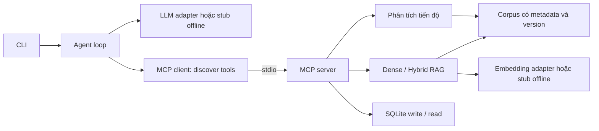

# Kiến trúc đồ án AIPR

Thiết kế chốt ngày 08/10/2026, dựa trên mock đã sửa audit. Đây là kiến trúc đích; xem README để biết phần nào đã hiện thực tại repo thật. Tài liệu thiết kế là đề xuất tổ chức, không phải tiêu chí chấm riêng.

## Bài toán và giới hạn

Trợ lý AI hỗ trợ quản lý và phân tích tiến độ dự án bằng RAG, Agent và MCP. Một sinh viên triển khai CLI và một agent loop tự viết; không thêm framework agent hoặc sản phẩm web.

Ba tầng: đọc kế hoạch/báo cáo/quy tắc có nguồn → tính tiến độ/chênh lệch/quá hạn → theo yêu cầu được phép tạo yêu cầu xử lý rủi ro vào SQLite và đọc xác minh.

Adapter live chỉ hoạt động khi có quyền; offline không nạp file key. Logs ghi config/revision, actions, tool observations và usage; không ghi credentials.

## Trách nhiệm module dự kiến

| File | Trách nhiệm |
|---|---|
| src/models.py | Dataclass/TypedDict, arguments, answer và JSON schema tool |
| src/data.py | Nạp/validate corpus, chọn phiên bản hợp lệ, phép tính tiến độ |
| src/store.py | SQLite, tạo request idempotent theo operation key, đọc bản ghi |
| src/api.py | HTTP adapter, config, timeout/retry hữu hạn, USAGE và embedding trace |
| src/hybrid.py, src/rag.py | Thuật toán hybrid tuần 4, chunking, dense/hybrid, metadata filter |
| src/mcp_server.py | Đăng ký năm tool, validate input, lỗi nghiệp vụ thành observation |
| src/mcp_client.py | Kết nối stdio, list_tools động, gọi tool theo schema |
| src/agent.py | Vòng lặp tự viết, parse JSON an toàn, MAX_STEPS, write → verify |
| src/runtime.py, src/cli.py | Cấu hình runtime riêng cho live và điều phối CLI |
| src/offline_model.py | Stub kiểm tra luồng; không thay bằng chứng LLM thật |
| scripts/eval.py | Testset hai mode, chấm refusal/citation/faithfulness, tổng hợp từ log |
| scripts/second_client.py | Host MCP thứ hai nhỏ, phần điểm cộng dự kiến |
| run.py, make.cmd, Makefile | Bootstrap và launcher; không chứa logic nghiệp vụ |
| templates/, data/, tests/ | Prompt ngoài code, corpus/provenance, testset và tests |

Không tạo thêm tầng service/repository/DI chỉ để có nhiều thư mục. MCP server là ranh giới tool; data/store/rag giữ logic dễ kiểm thử. AI chưa được tự đổi cấu trúc này.

## Hợp đồng tool và hành động

| Tool | Input chính | Kết quả/quy tắc |
|---|---|---|
| search_documents | query, project_id, as_of_date, mode, top_k | Chunk có metadata; điểm retrieval không chứng minh có đáp án |
| get_document | doc_id, version | Đọc chính xác tài liệu, kể cả phiên bản cũ khi so sánh |
| analyze_progress | project_id, as_of_date, compare_date tùy chọn | Phép tính và sources; no_answer hoặc insufficient_data khi phù hợp |
| create_followup_request | project_id, as_of_date | Chỉ ghi sau analysis có risk và quyền ghi; trả record + hợp đồng verify |
| get_followup_request | request_id | Đọc bản ghi; agent phải so khớp ngay sau write |

Tool nghiệp vụ được discover động. Host kiểm tra annotation/quyền trước write, dành ngân sách bước cho verify; server kiểm tra lại điều kiện. Write thành công nhưng read không khớp không được báo action_verified. HTTP lỗi và tool lỗi là hai ranh giới khác nhau, đều cần trace và xử lý hữu hạn.

## Dữ liệu và phép tính

- Metadata: doc_id, title, date, version, owner; thêm project_id/kind phục vụ lọc.
- Corpus tổng hợp có provenance, không coi là dữ liệu dự án ngoài đời. Một corpus phục vụ retrieval và phép tính.
- Version thay thế theo supersedes; giữ các biên bản độc lập. Missing/cyclic lineage, competing replacements hoặc nhiều baseline/policy/snapshot đang hiệu lực cùng slot phải báo lỗi, không chọn ngẫu nhiên.
- Block records trong content phải nhất quán với records có cấu trúc. Văn bản diễn giải vẫn cần sinh viên rà soát; validation block không chứng minh toàn bộ prose đúng.
- Tiến độ = tổng(effort_hours × progress_percent) / tổng(effort_hours). behind_pp = planned_progress − actual_progress, đơn vị **điểm phần trăm**.
- Task quá hạn khi deadline < as_of_date và actual < 100. Risk theo behind_pp ≥ threshold_pp hoặc có task quá hạn. Thiếu baseline/snapshot/policy/trọng số/số thực tế thì không tự điền dữ liệu.
- no_answer: corpus không có đáp án phù hợp; insufficient_data: có dự án/nguồn liên quan nhưng thiếu dữ liệu để tính/kết luận.

## Đối chiếu yêu cầu và bằng chứng cần có

Nguồn gốc: 01-De-tai-upload-for-student.pdf và 02-Yeu-cau-Thuc-hien.pdf. Theo quyết định sinh viên, không copy PDF vào repo; khi cần kiểm tra câu chữ/rubric phải có bản gốc, không tự bổ sung tiêu chí.

| Yêu cầu bắt buộc được tóm tắt | Bằng chứng repo thật |
|---|---|
| Ba tầng tra cứu → biến đổi → hành động/verify | Corpus, answer có nguồn, phép tính, trace SQLite write/read |
| Python 3.11+, typing, handwritten loop, retry/timeout, prompt ngoài code | Source, lock, templates, tests lỗi/MAX_STEPS |
| Dense + hybrid tái dùng tuần 4; metadata/version | hybrid/provenance, citation, giải thích chunking trong report |
| MCP stdio ≥2 tool, ≥1 write, stdout sạch, discovery | Năm tool theo bảng trên và trace/interop |
| Testset ≥12, ≥4 no_answer; faithfulness/refusal/USAGE | Bộ chính dự kiến 12 câu × hai mode = 24 lượt; số đo thật |
| ≥3 lần chạy thật có JSONL | Ba run độc lập đúng revision/config; resume không thành run mới |
| report.docx 8–9 trang, failure/hạn chế/đóng góp/phụ lục | Report số liệu thật, ≥1 failure analysis, ≥2 hạn chế, commit cá nhân |
| Repo .git, README setup/demo/eval, ai-usage và bảo vệ/sửa code | Repo/history thật, cold start và sinh viên tự giải thích |

Điểm cộng được liệt kê: metadata filter, so sánh cấu hình, host thứ hai, CSV/đồ thị. Không tự hứa đủ +6 vì bảng chỉ liệt kê bốn mục +1. Số unit tests của mock, LLM judge tự động và công cụ sinh Word không phải điều kiện bắt buộc riêng của môn.

Evaluation phải kiểm tra nội dung refusal, claim/citation và expected_sources; chỉ đúng status hoặc đúng doc_id chưa đủ. Offline có thể kiểm tra luồng/sources, nhưng không sinh điểm faithfulness/correct refusal của LLM thật. Dùng config gốc trong run log và tách embedding usage khỏi LLM/judge usage. Live đang chờ quyền và chưa có bằng chứng ở repo này.
